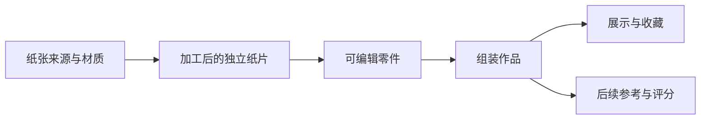

# 真实纸艺模拟器：产品定义

执行更新（2026-11-01）：已按本规格实施首轮 A4 白纸研究原型，见 [G1_VALIDATION.md](G1_VALIDATION.md)。产品目标不变，G1 尚未整体验收。以下“本轮只更新定义”等表述指规格制定时。

日期：2026-10-31。状态：根据用户最新方向整理的产品基线；具体手势与参数为待验证设计。本轮只更新定义、研究和实验计划，没有实现新的物理求解器。

本文件取代此前“按预设折法解谜、通关收藏教程”的产品主线。旧小狗原型作为既有技术样板保留，运行事实见 `NEXT_ROUND_VALIDATION.md`，不能作为自由纸张物理已经成立的证据。

## 1. 用户已明确的核心

Origami 首先是一套可以自由制作的纸艺模拟器。用户准备纸张，在三维空间中操作、加工、制作零件，再将零件组装为作品。目标成品、教程、提示、挑战和评分是此后的体验层。

必须遵守：

- 从可选纸材开始，允许裁剪初始纸形，而非只能使用关卡给定的方纸。
- 通过纸边、纸角或局部区域直接操纵纸张；折叠位置、方向、角度、顺序由用户决定，不从一组预设折线中选答案。
- 表达纸张的弯曲、折痕与展开行为，处理纸层之间的接触；以现实纸张为对照。
- 剪切、打孔是改变纸张的制作行为，加工后的纸张仍能继续折叠。
- 支持多张纸、多个零件和组装关系；一件作品不等于一张纸或一个网格。
- 工作区以纸张为中心，不用“下一步”“执行折叠”等步骤按钮推进制作。
- 用户可以只自由制作，不选择目标成品，也不接受评分。

“完全模拟现实”是产品方向。每个版本必须写清实际支持的纸材、操作、尺度、纸层数量和误差范围；没有实测前，不宣称无限复杂作品或手机上完全等同实物。

## 2. 制作过程

| 环节 | 用户行为 | 应保留的结果 |
| --- | --- | --- |
| 选纸 | 选材质、尺寸、颜色／正反面 | 实际纸张规格与材料预设版本 |
| 初始裁剪 | 改外轮廓、制作孔洞或分割纸张 | 轮廓、孔、碎片、原始纸张来源 |
| 自由折叠 | 抓持、提起、弯折、压痕、展开、回折 | 连续变形与持久折痕，不能只存步骤编号 |
| 加工 | 剪切、打孔；逐步支持折后多层加工 | 实际受影响的纸层、切口、孔洞及新碎片 |
| 零件管理 | 命名、单独查看、保存、继续加工 | 可继续编辑的零件及其组成纸片 |
| 组装 | 对齐、插接、穿套，必要时拆回 | 各零件姿态、接触及明确的连接关系 |
| 作品保存 | 保存整体，也保留零件 | 完整制作状态；展示模型只是派生产物 |

工具选择、材质设置、撤销、恢复和相机控制有明确用途，可收纳在简洁工具栏中。它们不承担替用户完成指定折法的作用。初始裁剪也属于正式制作数据，撤销后可以回到原纸。

胶粘等连接工具尚未由用户确定。第一组装实验使用可拆的插接／穿套样件，不默认把靠近的零件永久粘在一起。

## 3. “像纸”需要能观察到的行为

| 能力 | 体验要求 | 不足以证明该能力的现象 |
| --- | --- | --- |
| 面内形变 | 正常操作下难以拉长；材质差异可辨 | 外观像纸，但可以像橡胶一样拉伸 |
| 弯曲与回弹 | 轻弯、松手、重力下垂有连续响应 | 只沿已知轴转动刚性面片 |
| 永久折痕 | 压折后展开仍留有可再次折回的痕迹 | 松手恢复全平，或始终追随预设终角 |
| 自由折线 | 非网格方向、不同位置、交叉折痕均可尝试 | 只有事先准备的折线有效 |
| 纸层接触 | 能叠起、分开、滑动，考虑厚度及摩擦 | 仅按层号加显示偏移，允许互相穿过 |
| 加工 | 切掉的区域确实消失，孔洞贯通，余纸可变形 | 在材质上画黑洞或隐藏贴图 |
| 组装 | 多件保持独立，连接有可解释的方式 | 把模型视觉叠放后锁成一个刚体 |

第一阶段先研究一张纸的这些必要行为；加工与组装的要求从数据和算法评估起就纳入设计，避免做完固定拓扑后才发现无法扩展。

## 4. 直接操作与观察：待验证方案

屏幕触点只能直接提供二维位置，而纸上的抓持点可以在三维中运动。深度、固定另一侧和“压折”如何表达，需要和物理一起验证，不能仅把当前拖动距离换算为预设折角。

先比较两种交互原型：

- **提起并拖动**：命中纸边／纸角后，用连续手势表达提起和拖动；第二个纸上触点可成为另一只手。提起量和拖动平面的映射需要实验，不预先认定自动掀起就是自然操作。
- **临时固定与操作**：通过长按在纸上放置可解除的“另一只手”，随后自由抓持和移动其他区域。比较这是否降低小屏上同时操作的负担。

第一触点命中纸张时锁定为制作手势；第一触点落在空白时进入相机手势，后续手指不在同一手势中偷偷改换含义。纸张可以翻面、转动、缩放，接触下层纸时需要明确当前抓到的层；长按选层、临时分层观察等属于候选设计，不先用固定层号代替真实命中。

自由制作仍受材料和接触约束。抓持目标暂时不可达时，应体现阻力或限制运动，不能为了跟随手指而拉长纸张或穿过其他纸层。

触屏必须独立完成制作。倾斜或铰链可以作为虚拟抓持点／双手姿态的可选输入，经过校准后仍受材料和接触约束；不直接覆盖折角，也不同时无提示地控制相机与折纸。

## 5. 多零件作品的组织

一张纸剪开可以产生多个独立纸片；多个纸片也可能被归为同一个零件。零件本身还可以是子装配。管理上的分组不会自动产生物理连接，显示时也不能用一个静态合并网格取代可继续加工的数据。

保存至少覆盖原纸来源、材质、当前拓扑、空间形态、折痕／塑性状态、零件组成和连接。导出截图、OBJ 等展示结果，不等于保存了可编辑作品。

## 6. 后置体验

模拟器基本能力成立后，再开发：

- 成品库：展示由哪些零件组成，可查看空间结构。
- 辅助制作：从基础操作帮助、局部形态提示逐渐到可暂停示范；示范不限制自由制作模式。
- 目标挑战：允许不同制作路径；评分同时考虑几何形态、关键结构和组装关系，不能只比较一张投影图或规定步骤数。
- 收藏：保存作品和零件，支持继续编辑。

具体评分公式和内容扩容暂不立项，以免让模拟器围绕少数预设答案构建。

## 7. 本阶段的交付边界

现在推进的是技术可行性验证计划，入口为 `PAPER_SIMULATOR_TECHNICAL_PLAN.md`，实验细节为 `research/paper-simulator/EXPERIMENTS.md`。实验未运行，求解器未选定，手势未定稿。

下一次实施先交付“一张可自由操作的白纸”实验：连续抓持、非预设位置折叠、压痕／展开、基本自接触、状态保存。它通过后，按门槛推进加工及多件组装。任何阶段失败应如实调整方案，不能用限制到固定折线和自动完成动画来替代本产品要求。
