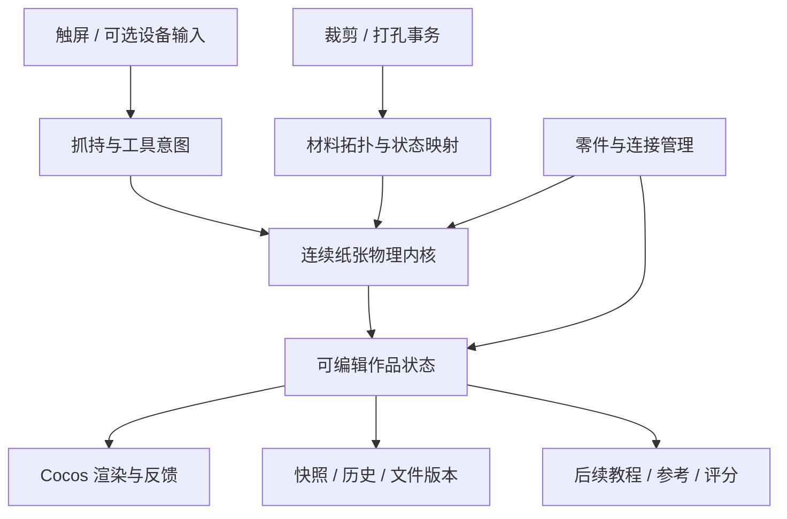

# 真实纸艺模拟器：技术研究与验证路线

执行更新（2026-11-01）：独立 C++ 内核与 iOS 白纸实验已进行首轮实现，现有两候选的数值对照与限制见 [G1_VALIDATION.md](G1_VALIDATION.md)。G1 尚未整体验收。以下“未执行／没有实现”是计划制定时的状态，不覆盖新的验证记录。

日期：2026-10-31。性质：案头研究、项目代码审阅和待执行实验设计。没有安装外部求解器、运行论文代码、测量新内核性能，或改动现有应用逻辑。产品要求以 [产品定义](PAPER_SIMULATOR_SPEC.md) 为准。

## 1. 研究后的判断

建议将纸张视为具有材料行为的可变形薄片：面内抗拉伸／剪切、面外弯曲、塑性折痕、带厚度的接触，以及可更新的材料拓扑。渲染引擎、物理内核、制作工具和作品数据分离。

当前不直接确定最终求解器。优先比较“XPBD 约束框架中的薄片模型”和“离散薄壳能量的隐式非线性求解”，用同一组白纸实验评价。碰撞／摩擦、永久折痕、动态拓扑是两者都必须解决的工作，不能因为采用某个算法名称就视为获得这些能力。

XPBD 是求解框架，薄壳是材料／离散模型，两者不是互斥的纸张种类。候选 A 将膜、弯曲和塑性状态表达为约束，候选 B 对对应的薄壳能量进行隐式非线性求解。对照时尽可能共用材料能量、网格和边界；若无法等价，明确差异，不能把更软的材料或不同接触条件当成速度优势。有限迭代下的收敛与网格尺度仍需实验。

这个候选顺序是本项目的工程判断，不是论文证明的手机性能结论。Cocos 暂时保留为已有渲染、输入和 iOS 宿主；若实测暴露障碍，再根据证据决定是否更换宿主。

## 2. 一手资料及其适用边界

以下是本轮实际查阅的作者论文、作者项目或格式规范，访问日期均为 2026-10-31。未执行或复现其代码。论文与项目的展示结果不能作为本项目的运行结果。

| 来源 | 已核实的内容 | 对本项目的用途与边界 |
| --- | --- | --- |
| [XPBD，Macklin 等，2016](https://mmacklin.com/xpbd.pdf) | 扩展 PBD，处理柔顺约束及传统 PBD 中刚度随时间步／迭代变化的问题 | 候选求解框架；不自动提供纸张塑性、切割和防穿透保证 |
| [Small Steps，Macklin 等，2019](https://mmacklin.com/smallsteps.pdf) | 比较大步多迭代与小步少迭代的约束模拟 | 为时间步／迭代实验提供依据；不是任何手机或纸材的预算证明 |
| [Folding and Crumpling Adaptive Sheets，Narain 等，2013，作者页面](https://jamesobrien.com/papers/Narain-FCA-2013-07/index.html)／[大学存档](https://escholarship.org/uc/item/6p48z6mj) | 研究薄片塑性、自适应网格对齐折痕，以及重网格时保存塑性形态 | 提示自由新折痕不能长期依赖固定三角边；需要保存材料历史；不据此承诺移动端实时 |
| [Adaptive Tearing and Cracking of Thin Sheets，Pfaff 等，2014，作者页面](https://tobiaspfaff.com/publication/pfaff-2014-adaptive/)／[论文](https://graphics.berkeley.edu/papers/Pfaff-ATC-2014-07/Pfaff-ATC-2014-07.pdf) | 研究薄片断裂、弹塑性与自适应网格的关系 | 作为拓扑变化与状态转移的参考；工具剪切可以先明确路径，不必先复现完整自动断裂 |
| [C-IPC，Li 等，2021](https://ipc-sim.github.io/C-IPC/) | 对薄结构的应变限制、厚度距离偏移和连续碰撞检测进行研究 | 作为接触质量对照及候选路线；其论文保证依赖完整算法与条件，不能移植到简化实现上照搬宣传 |
| [Origami Simulator 官方说明](https://origamisimulator.org/)／[源码](https://github.com/amandaghassaei/OrigamiSimulator) | 将输入折痕图驱动到折叠状态，支持交互和 GPU 计算 | 可研究预设折痕图与结构响应；不把它直接等同于从无折痕白纸随手产生新折痕的完整内核 |
| [FOLD 1.2 规范](https://github.com/edemaine/fold/blob/main/doc/spec.md) | 描述几何、折痕、空间状态、面片顺序及多个 frame，允许扩展字段 | 用于交换适配；完整材料历史、加工事务和装配数据需另行定义并版本化 |

资料获取说明：Berkeley 的两个原页面／PDF直接访问曾出现超时或 502；折叠研究通过作者页面、大学存档摘要核实，断裂研究通过作者页面及检索返回的原论文段落核实。未把这些论文标记为全文复现。Origami Simulator 顶层 [LICENSE](https://raw.githubusercontent.com/amandaghassaei/OrigamiSimulator/main/LICENSE) 为 MIT；若后续实际复用代码，需在选定版本上核对依赖和素材，而不是将论文公开访问当作代码授权。

## 3. 候选方案与决定条件

| 候选 | 适合先验证什么 | 必须正面解决的风险 | 当前决定 |
| --- | --- | --- | --- |
| XPBD 薄片：面内约束、弯曲及塑性状态 | 抓持响应、可控计算预算、材料差异 | 约束收敛、硬纸的残余拉伸、交叉折痕、层间接触；不能默认为布料改材质即可 | 主候选实验，不提前选定 |
| 离散薄壳／弹塑性能量＋隐式非线性求解 | 弯曲、折痕与能量行为的质量对照 | 非线性求解成本、接触成本、重网格后的历史传递、移动端部署 | 用小场景与主候选做质量／成本对比 |
| Bar-and-hinge／输入折痕图方法 | 已有折痕结构、参考样件或教学展示 | 通常需要明确折痕离散；单独使用不足以覆盖本产品的新折痕和任意加工要求 | 保留对照，不作为自由白纸已解决的依据 |
| 多边形沿轴旋转，即现有方案 | 原小狗回归、渲染与平台宿主 | 没有材料力学、真实接触和连续状态；自由折痕与拓扑语义不足 | 历史样板，不继续承担新内核 |

接触先对比可实现的连续碰撞检测＋接触约束方案与 C-IPC 类参考。普通点间排斥不足以说明边／面不会穿透；若简化接触在两层纸上就失败，应在扩张网格和纸张数量前调整。采用 C-IPC 也不代表需要立即把整套研究代码放进生产应用。

## 4. 架构与数据边界

内核接口围绕 `advance(dt)`、抓持约束、工具几何、拓扑编辑、读取状态及快照，不接受 `stepIndex`、`validFold` 或目标作品的正确路径。实验中的脚本抓持轨迹用于重复测试，是外部连续输入，不是在内核中写好某个折叠答案。

建议先保持内核与引擎无关，并采用适合连续数值数据的结构。若进入实现，优先评估可编译到 iOS 的 C++ 内核边界；是否增加 WASM／网页调试桥接由实验需求决定。暂不承诺微信、Web 与 iOS 具有相同容量，不为追求双端共用先锁定纯 TypeScript 求解器，也不提前投入 GPU 改写。

### 可编辑状态至少包含

| 对象 | 关键数据与约束 |
| --- | --- |
| `MaterialProfile` | 版本、厚度、克重、面内性质、弯曲、塑性及摩擦参数；区分实测和调试参数 |
| `SheetOrigin` | 原纸 ID、初始材料域、尺寸、正反面与材质来源 |
| `SheetBody` | 当前连通纸片、材料坐标、拓扑、位置、速度、质量、边界、孔洞、塑性历史 |
| `MaterialAnchor` | 纸片身份与材料域位置、所在侧及必要的谱系；不能只引用会被重网格替换的三角形数组下标 |
| `Part` | 一个或多个纸片／子零件的管理分组、局部编辑信息；分组不自动变成胶粘 |
| `Assembly` | 零件引用与明确连接、装配姿态；物理连接可以成环，场景父子树不能成环 |
| `EditHistory` | 抓持事务、加工事务、连接变更、检查点与版本；恢复时不靠逆向积分 |

材料坐标必须与当前三维位置分开：在折起的纸上切一个孔，会对应材料域中的新边界；现有 `u/v` 可供纹理参考，但尚未承担完整材料域与拓扑身份。

厚度、克重和质量关系必须一致。若以克重作为面密度，质量由有效材料面积计算，不能再乘一次厚度。材料预设不能仅换颜色；先用两种实物纸测量下垂、回弹和压痕差异，未经校准不使用“物理准确”的命名。

### 加工与状态更新

1. 工具在三维中形成路径／作用体，先确定实际交到哪些纸片、哪些层。
2. 将受影响区域映射到各自材料域，修改外轮廓、孔洞或切口，重新三角化并识别新的连通体。
3. 通过材料域和谱系转移质量、速度、折痕、塑性及抓持／连接锚点；碰撞邻接、排除对和加速结构一并更新。
4. 验证面积、质量、边界和引用，再原子提交；失败则恢复加工前快照。切断的锚点必须显式失效或重新归属，不能跳到另一片纸上。

第一加工实验做平纸上的直切、圆孔，以及继续折叠。随后才验证折后多层加工。多层打孔不能只在各层相同 UV 位置复制一个洞；斜切、错层和工具深度都可能改变实际影响范围。

### 组装与恢复

组装先允许移动、旋转和辅助对齐零件，随后验证实际插接／穿套接触。对齐辅助不产生永久约束；若未来提供胶粘，必须是明确工具操作和可保存的连接数据。

保存的是连续制作状态，包括半折形态和永久折痕。切后台要解除临时抓持并安全暂停，恢复时读取已保存的几何与材料状态，而不是退回某个“完整步骤”或自动压平。若保存前还在提交拓扑事务，则等待原子完成或恢复其前置快照。历史容量需要设预算，不能每帧无限复制全部网格。

## 5. 与现有项目的衔接

| 现有内容 | 可继续利用 | 需要替换或重新验证 |
| --- | --- | --- |
| iOS 构建、UIScene、原生桥接 | 平台宿主及既有构建修复 | 新内核桥接、性能、生命周期与状态保存 |
| `PaperView.ts` | 相机、双色表现、纸纹和动态网格经验 | 变拓扑上传、法线、边界与层次表现；现有正交相机不因此成为唯一交互方案 |
| `DeviceInput.ts` | 能力探测、主动启用、失效处理 | 从预设折角进度改为受约束的抓持输入，重新做真机实验 |
| `PaperModel.ts` / `Puzzle` | 原样保留供旧 Demo 回归 | 不向 `Fold`、`valid`、`step` 继续堆叠模拟器功能；建立新的状态模型 |
| 本地 v1 存档 | 继续保留原键和旧作品入口 | 新模拟器独立版本；旧面片缺失的材料历史不能凭空迁移成真实纸张 |
| 旧自动测试 | 证明旧样板仍可用 | 不能给新物理真实性、加工或组装背书 |

本轮不删除旧样板、不改存档、不更换引擎、不导入第三方模拟代码。实施时采用独立实验入口，直到新能力通过验收再接入主制作工作流。

## 6. 按门槛推进

| 门槛 | 交付与退出条件 | 下一步条件 |
| --- | --- | --- |
| G0 样件与实验协议 | 两种实物纸、材料记录、统一抓持轨迹、指标与设备记录模板；明确数值容差 | 可以公平比较候选，而不是挑不同演示 |
| G1 自由白纸 | 提起／弯曲、压痕／展开、不同位置和方向的新折线、两层自接触、连续状态保存；同场景比较两条求解路线 | 通过基础真实性和稳定性，才确定主内核 |
| G2 加工与重网格 | 初始裁剪、单层孔洞、碎片继续折叠、折痕状态转移；再做折后多层加工 | 没有质量丢失、幽灵约束或切后爆炸 |
| G3 多件组装 | 两个独立零件制作、插接／穿套、拆开与恢复，和实物样件对照 | 接触和保存可信，才扩作品复杂度 |
| G4 产品化实验 | 屏幕深度操作可理解、真实纸材可辨、手机持续运行达到选定预算 | 再启动成品库、提示和评分 |

输入实验从 G1 就参与，不等做完求解器才研究触屏；设备性能从最小原型开始记录，不能最后才发现手机不可用。G1 采用有限网格和纸材范围，不承诺无限复杂度；但必须接受用户自由选择折线的位置和方向。

完整实验及失败判据见 [EXPERIMENTS.md](research/paper-simulator/EXPERIMENTS.md)。所有门槛目前均为“未执行”，没有由旧小狗测试继承任何通过状态。时间、精度和容量以实验记录为准，不把工作日估计当交付承诺。

## 7. 关键决定

- 先证明自由白纸能成立，再进入加工、组装和成品体验。
- 同时设计材料域、拓扑身份和装配数据，但分阶段验证，不同时开发所有工具。
- 求解路线未定；XPBD 和隐式薄壳先做同题对照，接触质量不合格就调整，而非用层号遮掩穿透。
- 平台暂沿用已有 iOS／Cocos 宿主，真实可行容量需真机测量；现有安装连接问题也仍未解决。
- 本轮只有规划与研究，当前应用仍是预设折法 Demo。
